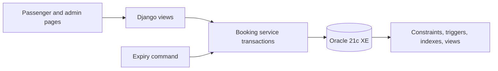

# Bus Ticket Booking System

Third-year CSE DBMS project: **Bus Ticket Booking System with Seat Reservation,
Waiting List, and Cancellation Management**.

The application is a local Django web app backed by Oracle Database 21c XE.
It demonstrates relational design, normalization, keys and constraints,
Oracle triggers and views, indexed queries, row locking, atomic transactions,
FIFO waiting-list offers, and a Data Pump recovery exercise. Payments and
refunds are simulated; no real money or bus service is involved.

## Requirements

- Windows with Oracle Database 21c XE and SQL Developer (or a compatible Oracle 21c installation).
- Python 3.14, Git, and a modern browser. The project has been exercised with
  Django 6.1.2 and `oracledb` 4.0.2; versions are pinned in `requirements.txt`.
- An Oracle pluggable database service such as `xepdb1` and an account with
  table, sequence, view, trigger, and procedure creation privileges.
- Internet for the initial Python package installation and GitHub push. The
  running local app uses its own CSS and does not fetch a CDN stylesheet.

## Database account

In SQL Developer, connect as an administrator to the `xepdb1` service. For a
fresh installation, choose a private password and run:

```sql
CREATE USER BUSBOOKING IDENTIFIED BY "ChooseYourOwnPassword";
GRANT CREATE SESSION, CREATE TABLE, CREATE SEQUENCE,
      CREATE VIEW, CREATE TRIGGER, CREATE PROCEDURE TO BUSBOOKING;
ALTER USER BUSBOOKING QUOTA UNLIMITED ON USERS;
```

Test a new SQL Developer connection as `BUSBOOKING` on host `localhost`, port
`1521`, service `xepdb1`. Do not use the administrative `SYSTEM` account for
the application. Do not commit a real password or database dump to Git.

## Run locally on Windows PowerShell

From the repository folder:

```powershell
py -3.14 -m venv .venv
.\.venv\Scripts\python.exe -m pip install -r requirements.txt
$secure = Read-Host "BUSBOOKING password" -AsSecureString
$env:DB_PASSWORD = [System.Net.NetworkCredential]::new("", $secure).Password
.\.venv\Scripts\python.exe manage.py migrate
.\.venv\Scripts\python.exe manage.py createsuperuser
.\.venv\Scripts\python.exe manage.py runserver
```

Keep the server PowerShell window open while browsing
`http://127.0.0.1:8000/`. Use another PowerShell window for Git commands.
Set `DB_PASSWORD` again in each new window that runs database commands. The
database connection defaults to `localhost:1521/xepdb1`; `DB_DSN` and
`DB_USER` can override it. `.env.example` documents these variables but is
**not** automatically loaded.

## First use

1. Sign in to `/admin/` with the Django superuser. Add a bus and its physical
   seats together, then add a future trip using that bus. The admin creates
   one `TripSeat` inventory row per bus seat for the new trip.
2. Open `/` and create a passenger account. Search for the trip, select up to
   six seats, and hold them for 10 minutes. Search can sort by departure or
   fare and show only trips with bookable seats. Simulate payment to confirm.
3. View the booking under **My bookings**. A confirmed ticket can be printed.
   Whole-booking cancellation releases its seats and records a simulated full
   refund. The booking detail page shows the lifecycle timestamps and the
   related simulated payment record; the printed ticket stays concise.
4. When a trip is full, another passenger can join the waiting list. A
   cancellation offers a released seat to the first waiting passenger for 10
   minutes. **My bookings** shows the Oracle FIFO queue position and any live
   offer. A passenger can leave the list; declining an offer passes that seat
   to the next waiting passenger.
5. Admin users can open `/insights/` for occupancy and simulated revenue
   graphics sourced from Oracle reporting views.

Expired holds and offers are processed when the trip seat map is accessed.
Run `manage.py process_expiries` periodically if you want automatic cleanup
while no one is browsing. Repeated runs are safe.

## DBMS verification

Run these commands with `DB_PASSWORD` set. They create isolated test records
and remove them when finished:

```powershell
.\.venv\Scripts\python.exe manage.py verify_integrity
.\.venv\Scripts\python.exe manage.py verify_seat_race
.\.venv\Scripts\python.exe manage.py verify_atomic_hold
.\.venv\Scripts\python.exe manage.py verify_waitlist_fifo
.\.venv\Scripts\python.exe manage.py verify_waitlist_leave
```

Read `docs/er_model.md` for the ER diagram and normalization discussion,
`docs/dbms_demo_path.md` for the presentation sequence, and
`docs/observed_dbms_results.md` for recorded local results. Run
`docs/dbms_evidence.sql` and `docs/query_plans.sql` in SQL Developer as
`BUSBOOKING`. `docs/recovery_drill.md` documents the Oracle Data Pump export
and verified restore into a separate schema.

## Architecture and scope



The first version handles direct trips, one fare per trip, one currency (INR),
whole-booking cancellation, and single-seat waiting-list requests. It uses
Django's development server and a local-only development configuration;
`DEBUG` and the fallback secret key must be changed before any public
deployment. Real payments, intermediate-stop seat reuse, operator APIs, and
production hosting are outside the current project scope.
