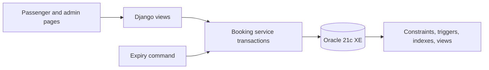

# Bus Ticket Booking System

Third-year CSE DBMS project: **Bus Ticket Booking System with Seat Reservation,
Waiting List, and Cancellation Management**.

The application is a local Django web app backed by Oracle Database 21c XE.
It demonstrates relational design, normalization, keys and constraints,
Oracle triggers and views, indexed queries, row locking, atomic transactions,
FIFO waiting-list offers, conditional uniqueness for active queue entries,
an Oracle booking-status audit trail, and a Data Pump recovery exercise.
Payments and refunds are simulated; no real money or bus service is involved.

**Team manual (PDF):** [Download the illustrated user manual](docs/BusBook_Team_User_Manual.pdf)
for starting the app offline or on a shared network and using its features.

**Detailed project report:** [Read the PDF](docs/BusBook_Detailed_Project_Report.pdf)
or [edit the Markdown source](docs/full_project_report.md). It documents the
technical and Oracle architecture, DBMS concepts, features, verification,
current live snapshot, and future scope.

**New to this repository?** Follow the [complete installation and network
guide](docs/setup_and_network.md). It covers a fresh computer, an offline
demonstration, sharing on college Wi-Fi or a hotspot, and what public internet
hosting would require. For teammates using one shared installation, use the
[team access guide](docs/team_access.md).

## Requirements

- Windows with Oracle Database 21c XE and SQL Developer (or a compatible Oracle 21c installation).
- Python 3.14, Git, and a modern browser. The project has been exercised with
  Django 6.1.2 and `oracledb` 4.0.2; versions are pinned in `requirements.txt`.
- An Oracle pluggable database service such as `xepdb1` and an account with
  table, sequence, view, trigger, and procedure creation privileges.
- Internet for the initial Python package installation and GitHub push. The
  running local app uses its own CSS and does not fetch a CDN stylesheet.

## Database account

In SQL Developer, connect as an administrator to the `xepdb1` service. For a
fresh installation, choose a private password and run:

```sql
CREATE USER BUSBOOKING IDENTIFIED BY "ChooseYourOwnPassword";
GRANT CREATE SESSION, CREATE TABLE, CREATE SEQUENCE,
      CREATE VIEW, CREATE TRIGGER, CREATE PROCEDURE TO BUSBOOKING;
ALTER USER BUSBOOKING QUOTA UNLIMITED ON USERS;
```

Test a new SQL Developer connection as `BUSBOOKING` on host `localhost`, port
`1521`, service `xepdb1`. Do not use the administrative `SYSTEM` account for
the application. Do not commit a real password or database dump to Git.

## Run locally on Windows PowerShell

From the repository folder:

```powershell
py -3.14 -m venv .venv
.\.venv\Scripts\python.exe -m pip install -r requirements.txt
$secure = Read-Host "BUSBOOKING password" -AsSecureString
$env:DB_PASSWORD = [System.Net.NetworkCredential]::new("", $secure).Password
.\.venv\Scripts\python.exe manage.py migrate
.\.venv\Scripts\python.exe manage.py createsuperuser
.\.venv\Scripts\python.exe manage.py runserver
```

Keep the server PowerShell window open while browsing
`http://127.0.0.1:8000/`. Use another PowerShell window for Git commands.
Set `DB_PASSWORD` again in each new window that runs database commands. The
database connection defaults to `localhost:1521/xepdb1`; `DB_DSN` and
`DB_USER` can override it. `.env.example` documents these variables but is
**not** automatically loaded.

## First use

For teammates using the app on the same Wi-Fi and separate personal accounts,
follow [the team access guide](docs/team_access.md). GitHub access is separate
from app accounts; teammates need only a browser for shared-app testing.
The `start_team.ps1` launcher detects the current local network address and
prints the teammate link; restart it after changing Wi-Fi or hotspot.

1. Sign in to `/admin/` with the Django superuser. Add a bus and its physical
   seats together, then add a future trip using that bus. The admin creates
   one `TripSeat` inventory row per bus seat for the new trip.
   To populate a varied schedule quickly, run `manage.py seed_fleet` with
   `DB_PASSWORD` set: it defines 12 buses and future trips without
   clearing existing bookings. Run `manage.py upgrade_fleet` to expand **all**
   buses already in the database to at least 24 seats and add the missing
   trip-seat inventory rows. Existing booked seats and booking references stay
   intact. Run `manage.py generate_daily_trips --days 14` to create a rolling
   two-week window from daily route templates; repeat it as needed. Duplicate
   or overlapping bus time slots are skipped. Admin can edit daily templates
   under **Recurring trips**. A bus cannot have overlapping active trips;
   back-to-back trips and trips on other buses are allowed.
   See [fleet and schedule design](docs/fleet_schedule.md) for the Oracle rule
   and a SQL Developer query. The [layout and daily trip guide](docs/fleet_layout_and_daily_trips.md)
   explains the upgrade and verification commands. `start_team.ps1` refreshes
   the next 14 days of daily trips when launched.
2. Open `/` and create a passenger account. Search for the trip, select the
   seats you need, enter passenger name and contact phone, and hold them for
   10 minutes. The ticket shows those details, journey date, approximate
   arrival time, and each seat's deck and berth type. The search uses database-backed
   origin, destination, bus-type, and operator menus; changing the origin
   narrows the destination choices. Filter by travel date or bookable seats,
   then sort by departure or fare. Simulate payment to confirm.
3. View the booking under **My bookings**. A confirmed ticket can be printed.
   Whole-booking cancellation releases its seats and records a simulated full
   refund. The booking detail page shows the lifecycle timestamps and the
   related simulated payment record; the printed ticket stays concise.
4. When a trip is full, another passenger can join the waiting list. A
   cancellation offers a released seat to the first waiting passenger for 10
   minutes. **My bookings** shows the Oracle FIFO queue position and any live
   offer. A passenger can leave the list; declining an offer passes that seat
   to the next waiting passenger.
5. Admin users can open `/staff/overview/` for fleet, passenger, booking, and
   cancellation totals, or `/staff/revenue/` for captured, refunded, and net
   simulated amounts by trip. Both pages are linked from `/admin/`.
6. Admin users can open `/insights/` for occupancy, simulated revenue, and
   active waiting-list demand sourced from Oracle reporting views.

Expired holds and offers are processed when the trip seat map is accessed.
Each trip has a default city bus-stand boarding and drop-off point; staff can
add more timed points under **Trip points** in admin. Passengers choose points
when holding a seat or accepting an offer. A booking saves its seat subtotal,
₹20 platform fee, ₹10 service fee, and illustrative 18% GST on those fees
(₹5.40), then charges the same total in the simulated payment record. Older
bookings keep their original total without retroactive fees. The ticket shows
the full breakdown and the selected journey points.

After a confirmed trip has arrived, its passenger can submit one 1–5 star bus
review from the booking page. Trip search shows the average of verified
reviews. The footer links to an in-app support desk where signed-in passengers
can submit questions and track responses; staff handle requests in admin.
No telephone number or real payment service is represented in this demo.

Run `manage.py process_expiries` periodically if you want automatic cleanup
while no one is browsing. Repeated runs are safe.
Cancelled, departed, and inactive-bus trips cannot accept new holds or queue
entries. Their seat map shows booking as closed.

## DBMS verification

Run these commands with `DB_PASSWORD` set. They create isolated test records
and remove them when finished:

```powershell
.\.venv\Scripts\python.exe manage.py verify_integrity
.\.venv\Scripts\python.exe manage.py verify_seat_race
.\.venv\Scripts\python.exe manage.py verify_atomic_hold
.\.venv\Scripts\python.exe manage.py verify_waitlist_fifo
.\.venv\Scripts\python.exe manage.py verify_waitlist_leave
.\.venv\Scripts\python.exe manage.py verify_active_waitlist
.\.venv\Scripts\python.exe manage.py verify_booking_audit
.\.venv\Scripts\python.exe manage.py verify_offer_rules
.\.venv\Scripts\python.exe manage.py verify_trip_schedule
```

To show a nonempty queue chart without changing your real trip, run
`manage.py preview_waitlist_demand` in a separate PowerShell window with
`DB_PASSWORD` set. While it pauses, refresh `/insights/` as staff and capture
the chart. Press Enter in PowerShell to remove all temporary rows. The seat
offer lasts 10 minutes; rerun the command if it expires before the screenshot.

Read `docs/er_model.md` for the ER diagram and normalization discussion,
`docs/dbms_demo_path.md` for the presentation sequence,
`docs/live_sql_demo.sql` with `docs/live_sql_demo.md` for a read-only SQL
Developer walkthrough, and
`docs/observed_dbms_results.md` for recorded local results. Run
`docs/dbms_evidence.sql` and `docs/query_plans.sql` in SQL Developer as
`BUSBOOKING`. `docs/recovery_drill.md` documents the Oracle Data Pump export
and verified restore into a separate schema.

Booking status events are written by an Oracle trigger from migration `0006`.
The booking's Django admin page shows its audit rows. Events begin when that
migration is applied; earlier booking transitions are not reconstructed.

## Architecture and scope



The first version handles direct trips, one fare per trip, one currency (INR),
whole-booking cancellation, and single-seat waiting-list requests. It uses
Django's development server and a local-only development configuration;
`DEBUG` and the fallback secret key must be changed before any public
deployment. Real payments, intermediate-stop seat reuse, operator APIs, and
production hosting are outside the current project scope.
