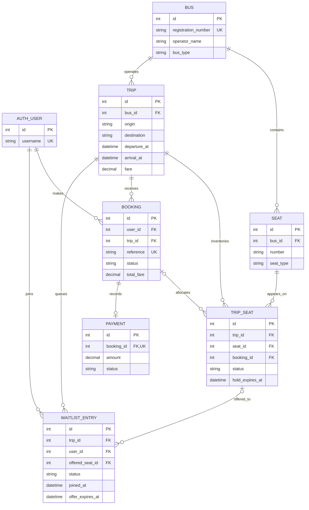

# Entity–relationship model and normalization

This diagram reflects the implemented Django models and Oracle tables. A
nullable relationship is shown with a circle. `AUTH_USER` is Django's user
table; the other entities belong to the booking application.

## Why these tables are separate

The candidate key for a physical seat is `(bus_id, number)`. The candidate key
for seat inventory is `(trip_id, seat_id)`. A bus seat can therefore appear on
many trips while each trip has only one inventory row for that physical seat.
`booking_id` in `TRIP_SEAT` is nullable: an available seat has no owner. A
booking can own several seats, but the Oracle trigger ensures its trip matches
every allocated inventory row. Another trigger checks that the physical seat
belongs to the trip's bus.

## Normalization argument

1. **First normal form:** Each column stores one value. Seats selected for a
   booking are separate `TRIP_SEAT` rows rather than a comma-separated seat
   list in `BOOKING`.
2. **Second normal form:** The logical composite keys `(bus_id, number)` and
   `(trip_id, seat_id)` determine facts about one seat or one trip-seat pair.
   Bus details are stored in `BUS`, trip details in `TRIP`, and inventory state
   in `TRIP_SEAT`, avoiding partial dependency on either side of the pair.
3. **Third normal form:** Descriptive facts about the bus, trip, user, and
   payment are stored with their own entity rather than copied into every
   booking or inventory row. Foreign keys connect the entities. For example,
   a booking stores `trip_id` instead of repeating origin, destination, and
   departure time.

Two values are deliberate snapshots rather than a claim of strict derivation:
`BOOKING.total_fare` preserves the price charged when the booking was made,
even if the trip fare changes later. `TRIP_SEAT.status` is stored for direct
inventory locking and must agree with its nullable booking and hold deadline;
the `CK_INVENTORY_STATE` check constraint enforces those combinations.

`BUS.operator_name` is currently a label for each bus. If the project later
needs operator-level accounts, contacts, or policies, move operators into a
separate `OPERATOR` table and reference it from `BUS`. This is a future
normalization extension, not an implemented table.
