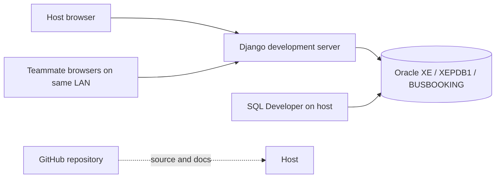
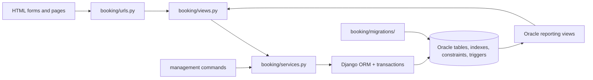
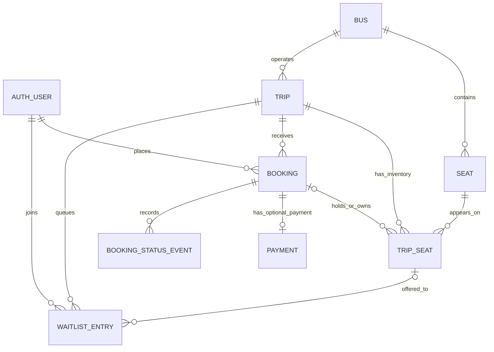

# Bus Ticket Booking System with Seat Reservation, Waiting List, and Cancellation Management

**Detailed project report | Third-year CSE DBMS project | IIITDM Kurnool**  
**Project state reviewed:** 2 November 2026  
**Implementation:** Oracle Database 21c XE, Django 6.1.2, Python 3.14, python-oracledb 4.0.2  
**Team:** three students; individual names and institutional approval details are intentionally left for the team to add before submission.

> This report describes the implemented project and the evidence available at the review date. Payments, refunds, operators, routes, fares, and tickets are simulated for academic demonstration. The system is not a real travel or payment service. Live database counts are a dated snapshot, not permanent constants.

## Abstract

The project implements a browser-based bus ticket booking application backed by Oracle 21c XE. A passenger can search future trips, view a bus-style seat map, hold up to six seats for ten minutes, confirm a simulated payment, view and print a ticket, cancel the entire booking, and receive a simulated refund. If a trip is full, a passenger can join a first-in, first-out waiting list. A released seat is offered to the next passenger for ten minutes. Staff can manage buses, seats, trips, and users through Django admin and view occupancy, revenue, and queue-demand reports calculated by Oracle views.

The database is central to the design. Normalized tables model buses, physical seats, trips, per-trip inventory, bookings, simulated payments, waiting entries, and status history. Primary, foreign, unique, and check constraints protect local rules. Oracle triggers enforce cross-table consistency and non-overlapping schedules, while function-based unique indexes enforce conditional uniqueness for active waiting-list rows and live offers. Atomic transactions and row locks prevent partial multi-seat reservations and double booking. Analytic SQL gives queue position, reporting views provide live metrics, and a Data Pump export/import drill demonstrated recovery into an independent schema.

At review, the live `BUSBOOKING` schema contained 13 buses, 33 trips, 244 physical seats, 640 trip-seat inventory rows, 8 bookings, 7 simulated payments, 1 historical waiting-list entry, and 3 audit events. Of these, 12 buses and 32 trips came from the expanded demo fleet. All three project reporting views and four project triggers were `VALID`; a read-only schedule check found zero overlapping active trip pairs. These totals may change as the team tests the app.

## 1. Problem, objectives, and scope

### 1.1 Problem statement

A seat must be available on a particular scheduled trip, not merely on a bus in general. Simultaneous passengers must never receive the same trip seat. A cancellation should release seats and, when demand exists, make a fair offer to a waiting passenger. The project also needs a traceable booking lifecycle, meaningful Oracle objects, and a usable interface so the database rules can be demonstrated in a real workflow.

### 1.2 Objectives

1. Represent bus, route schedule, physical seat, trip inventory, booking, payment, and waiting-list data with clear relationships and minimal repetition.
2. Make seat reservation and cancellation atomic and safe under concurrent requests.
3. Enforce important integrity rules in Oracle, including rules that a simple foreign key cannot express.
4. Provide fair, time-limited waiting-list promotion after a seat is released.
5. Expose database calculations through occupancy, simulated revenue, and queue-position views.
6. Give passengers and staff an application-like interface, while keeping Oracle visible in the demonstration.
7. Produce reproducible evidence: verification commands, SQL worksheets, execution plans, and a backup/restore drill.
8. Keep code and documentation in GitHub checkpoints and support a local shared demo across Wi-Fi or a hotspot.

### 1.3 Implemented scope

The application supports direct origin-to-destination trips, one fare per trip in INR, bus and seat administration, up to six seats per booking, ten-minute holds, simulated capture/refund, whole-booking cancellation, single-seat waiting-list offers, staff reporting, separate website accounts, printable tickets, and a locally shared demonstration. The demo seed defines 12 buses and 32 future trips across nearby states; a separately created bus and trip also remain in the current database.

### 1.4 Deliberate boundaries

There is no real payment gateway, ticket validation at a terminal, SMS/email notification, operator API, intermediate stop or segment-based seat reuse, partial booking cancellation, or public production deployment. The Django development server uses local HTTP, `DEBUG=True`, and a development fallback secret key; those settings are unsuitable for public internet hosting. The app can run without internet after setup, and teammates can reach one host on a shared local network. GitHub hosts source code, not the live Oracle database or web app.

## 2. Requirements and methodology

### 2.1 Software and deployment requirements

| Component | Current role | Where it runs |
| --- | --- | --- |
| Oracle Database 21c XE, `xepdb1` | Relational storage, constraints, triggers, indexes, SQL views | Host Windows laptop |
| SQL Developer | Schema inspection, SQL worksheet, execution plans | Host laptop; useful for presentation |
| Python 3.14, Django 6.1.2 | HTTP app, forms, authentication, ORM, admin, business service layer | Host laptop |
| python-oracledb 4.0.2 | Oracle connection through Django backend | Host laptop |
| Browser | Passenger, staff, and admin pages | Host or teammate device |
| PowerShell `start_team.ps1` | Detect local IPv4 addresses and start shared development server | Host laptop |
| Git and GitHub | Versioned code, report, manual, checkpoints | Host or contributors; internet needed for push |

The host computer needs enough memory and disk for Oracle XE, Python, and the browser. Teammates using the shared installation only need a browser and access to the same Wi-Fi or hotspot. Separate installations need their own Oracle instance, Python environment, migrations, and accounts. No measured hardware benchmark or vendor minimum is claimed here.

### 2.2 Development method

We used incremental implementation and verification. First we set up a dedicated Oracle schema and connected Django. Next we built the relational schema and migrations. We added booking, cancellation, waiting-list behavior, then database-level rules and dedicated probes. Reporting views and SQL worksheets were added alongside UI screens. We exercised concurrency, rollback, FIFO promotion, query plans, and Data Pump recovery. Finally we expanded the fleet, added a no-overlap schedule rule, improved the interface, created a team launcher, and wrote user documentation. Git commits and pushes preserve checkpoints; the commit history records when each increment was added.

| Phase | Intended result | Evidence of completion |
| --- | --- | --- |
| Foundation | Oracle account, Django connection and migrations | `manage.py check`, successful base migrations |
| Model | Normalized entities and per-trip seats | Models, migration `0001`, ER/normalization notes |
| Passenger flow | Search, holds, confirmation, cancellation | Live ticket and refund demonstrations |
| Waiting list | FIFO queue, timed offer, acceptance/exit | `verify_waitlist_fifo`, `verify_waitlist_leave` |
| Database hardening | Cross-table triggers, conditional uniqueness, audit, schedule guard | Migrations `0003` to `0010` and verification commands |
| Evidence | Reporting views, plans, recovery | SQL worksheets, observed outputs, Data Pump restore drill |
| Usability | Styled pages, seat map, print ticket, team access | Browser screenshots, local CSS, team manual and launcher |
| Fleet expansion | Many operators, bus types and routes | `seed_fleet`; 12 demo buses/32 demo trips present in live schema at review |

The trigger migrations for audit and trip scheduling initially compiled invalid PL/SQL because of missing terminators. We inspected Oracle compiler errors, corrected the original migration for fresh installations, and added a follow-up recompilation migration for existing installations. Both triggers were `VALID` at review. This is part of the project's actual iterative method, not a claim that the first attempt worked flawlessly.

## 3. General and technical architecture

### 3.1 Deployment view



The server binds to `0.0.0.0:8000` for a team demo. `start_team.ps1` finds active local IPv4 addresses and sets `BUSBOOK_LAN_HOST`, which Django adds to `ALLOWED_HOSTS`. The host can still use `127.0.0.1`. On a network switch, the server is restarted and a new teammate link is shared; the Oracle database and accounts do not move. A campus network may isolate devices, so a shared hotspot is the fallback. This is local-network access whether the Wi-Fi has internet or not; public hosting is a separate future task.

### 3.2 Application layers and request path



The browser submits standard HTTP forms. URL routing selects a view. Views enforce login and request method rules, read form data, and render templates. The booking service owns atomic changes to booking, seat inventory, payment, and waiting-list rows. Django's Oracle backend maps ORM operations to SQL; some read-only reports are queried with explicit SQL. Oracle commits or rejects the transaction based on schema constraints and triggers. Templates and local CSS present the result. Django admin is a separate staff interface over the same models and schema.

**Project modules and responsibility:**

| Module | Responsibility |
| --- | --- |
| `busbooking/settings.py`, `urls.py` | Oracle connection and project URL configuration; host settings |
| `booking/models.py` | Entity fields, relationships, check and unique metadata, admin-facing trip validation |
| `booking/views.py`, `booking/urls.py` | Search, seat map, accounts, booking pages, queue actions, staff insights |
| `booking/services.py` | Atomic hold, confirm, cancel, expiry, FIFO offer, join and leave operations |
| `booking/admin.py` | Bus/seat/trip management and booking/audit inspection |
| `booking/migrations/` | Versioned Oracle DDL: tables, constraints, triggers, indexes, views |
| `booking/management/commands/` | Seed data, expiry processing, repeatable DBMS verification probes |
| `templates/booking/`, `booking/static/booking/` | Passenger/staff UI, seat graphics, local stylesheet, college branding |

### 3.3 Principal request and transaction flows

**Seat hold:** The passenger selects one to six available inventory IDs. `hold_seats` starts an atomic transaction, locks the trip, releases stale holds/offers, locks selected trip-seat rows in stable ID order, and rejects a missing, booked, held, or live-offered seat. It creates a `HELD` booking with a ten-minute deadline and changes every selected inventory row to `HELD` with the same booking and deadline. A failure aborts the entire transaction. The Oracle booking audit trigger records the initial status in the same transaction.

**Confirmation:** `confirm_booking` locks the passenger's booking, checks it remains `HELD` and unexpired, creates one simulated `CAPTURED` payment, marks its inventory `BOOKED`, stores the confirmation time, and changes booking status to `CONFIRMED`. Repeating the request for an already confirmed booking returns the existing booking rather than charging again. The audit trigger records the transition.

**Cancellation:** `cancel_booking` locks the trip, booking, and allocated seats, releases those seats, changes a confirmed payment to `REFUNDED`, records the cancellation time and status, then offers released seats to waiting passengers in FIFO order. A held booking can be cancelled without a payment. A trip that has departed cannot be cancelled through this flow. The booking and payment remain as history; only current seat ownership is cleared.

**Waiting list:** A passenger may join only when no directly bookable seat remains. Active entries have `WAITING` or `OFFERED` status. On release, `_offer_next` selects the oldest waiting entry ordered by `joined_at, id`, locks it, and gives it a specific available seat with a ten-minute expiry. Acceptance calls the same atomic hold operation for that one offered seat, then marks the entry `ACCEPTED`. Leaving or an expired offer can pass the seat to the next passenger. The queue view calculates display positions separately from current status storage.

**Expiry behavior:** Visiting a trip seat map, opening relevant booking history, or running `process_expiries` processes stale holds and offers. The command is available for periodic execution, but a continuously running scheduler is not included. An expiry may therefore be processed at the next visit or command run rather than precisely at the deadline when the system is idle.

### 3.4 Access control, state transitions, and failure boundaries

Public visitors can view the searchable home page and a trip's seat map. Creating a hold, joining/leaving the queue, accepting an offer, viewing personal bookings, confirming, and cancelling require a signed-in user. Booking detail queries filter by both booking ID and `request.user`; a passenger cannot use the normal view to open another passenger's ticket. The Insights view requires Django staff status. Django admin requires staff access; the project leader may grant trusted teammates separate superuser accounts, but this is broad permission and should be used only for the three-person classroom team. Oracle's `BUSBOOKING` login is a different credential from every website login.

| Stored object | Main states | Typical transitions |
| --- | --- | --- |
| Booking | `HELD`, `CONFIRMED`, `CANCELLED`, `EXPIRED` | Hold → confirm; hold → expire/cancel; confirmed → cancel |
| TripSeat | `AVAILABLE`, `HELD`, `BOOKED` | Available → held → booked; held/booked → available after expiry/cancel |
| WaitlistEntry | `WAITING`, `OFFERED`, `ACCEPTED`, `EXPIRED`, `CANCELLED` | Waiting → offered → accepted; offer → expired/left; waiting → left |
| Payment | `CAPTURED`, `REFUNDED` | Confirmed capture → simulated refund on cancellation |

State changes are performed by service functions, and database check constraints restrict impossible status/field combinations. A stale seat selection returns a conflict message and asks the passenger to refresh. A timed-out hold cannot be confirmed. A wrong-trip seat is rejected by an Oracle trigger even if a caller bypasses the browser. If any step in a transaction fails, Oracle rolls back the related booking, inventory, payment, queue and audit writes together. The UI uses the current database values after redirect rather than trusting a previously displayed seat map.

### 3.5 Why this architecture was chosen

Django supplies routing, authentication, forms, admin, templates, and an Oracle-capable ORM quickly enough for a short academic schedule. A separate service module concentrates seat-changing operations so a view or management command does not implement its own competing reservation logic. Oracle owns data integrity, conditional uniqueness, audit history, reporting views, and transaction isolation; these rules continue to apply when data is written through SQL Developer or another client. `TripSeat` trades additional rows for a simple, lockable unit of availability per trip. The result is a demonstrable DBMS project with a working interface, while acknowledging that a production distributed booking system would require more infrastructure and operational controls.

## 4. DBMS architecture and data model

### 4.1 Conceptual and logical model



`AUTH_USER` is Django's authentication table. The eight booking-domain tables are `BUS`, `SEAT`, `TRIP`, `TRIP_SEAT`, `BOOKING`, `PAYMENT`, `WAITLIST_ENTRY`, and `BOOKING_STATUS_EVENT`. Django's physical Oracle tables have `BOOKING_` prefixes (for example `BOOKING_TRIPSEAT`). Each table has a surrogate numeric primary key. The relationships above are implemented with foreign keys; business uniqueness and state rules add further restrictions.

| Entity | Main attributes and keys | Purpose |
| --- | --- | --- |
| Bus | `id` PK; `registration_number` unique; operator, type, active flag | Physical vehicle and identity |
| Seat | `id` PK; `bus_id` FK; number and type; unique `(bus_id, number)` | Physical seat belonging to one bus |
| Trip | `id` PK; `bus_id` FK; origin, destination, departure, arrival, fare, cancelled flag | One dated journey of one bus |
| TripSeat | `id` PK; `trip_id`, `seat_id` FKs; optional `booking_id`; status, hold deadline; unique `(trip_id, seat_id)` | Seat state for one scheduled trip |
| Booking | `id` PK; unique reference; passenger and trip FKs; status, fare snapshot and timestamps | Passenger reservation lifecycle |
| Payment | `id` PK; unique `booking_id` FK; amount, status, capture/refund times | Simulated financial lifecycle |
| WaitlistEntry | `id` PK; passenger/trip FKs; optional offered trip-seat FK; status, join/offer times | Queue history and timed offer |
| BookingStatusEvent | `id` PK; booking FK; old/new status and Oracle timestamp | Database-written audit history |

`TRIP_SEAT` is the critical associative entity. A physical seat belongs to a bus, but each trip requires its own availability row. Thus the same physical seat can be booked on Tuesday and remain available on Thursday. A booking can own several trip-seat rows; a seat may have no booking when available. This design also makes seat-level locking possible.

### 4.2 Normalization and intentional snapshots

**First normal form:** Values are atomic. A booking's multiple seats are separate `TRIP_SEAT` rows, not a comma-separated list. **Second normal form:** The logical candidate keys `(bus_id, number)` and `(trip_id, seat_id)` identify one physical seat and one inventory position; bus and trip descriptions are not duplicated across these pairs. **Third normal form:** Bus facts, trip facts, user identity, payment facts, and queue facts are stored in their own tables. A booking references a trip rather than copying its origin, destination, bus type, and time.

`BOOKING.total_fare` is deliberately stored as the agreed price snapshot: it should not change if an administrator later edits the trip's current fare. `TRIP_SEAT.status` is stored for fast inventory checks and locking, and a check constraint requires coherent combinations of status, booking owner, and hold deadline. `BOOKING_STATUS_EVENT` is an append-only transition history in normal application use; it is not a replacement for the current booking status. `BUS.operator_name` remains text rather than a separate operator table because the current project does not manage operator accounts, contracts, or policies. A dedicated operator entity is a future normalization step.

### 4.3 Physical schema and integrity rules

| DBMS mechanism | Implemented use | Benefit |
| --- | --- | --- |
| Primary and foreign keys | All entities and relationships | Prevent orphan references and give stable joins |
| Ordinary unique constraints | Bus registration, bus seat number, trip-seat pair, booking reference, one payment per booking | Prevent duplicates at the database boundary |
| Check constraints | Positive/nonnegative monetary values, valid statuses, arrival after departure, origin different from destination, coherent inventory and queue states | Reject invalid rows even outside the UI |
| `TRG_TRIPSEAT_SAME_TRIP_BUS` | Seat must belong to trip's bus; assigned booking must belong to same trip | Enforces multi-table rules not expressible by one FK |
| `TRG_WAITLIST_OFFER_TRIP` | Offered inventory seat must belong to waiting entry's trip | Prevents cross-trip offers |
| `TRG_BOOKING_STATUS_AUDIT` | Writes old/new status and time on insert or actual transition | Preserves Oracle-generated lifecycle evidence |
| `TRG_TRIP_NO_OVERLAP` | Serializes scheduling by bus and rejects overlapping active trip intervals | Prevents a bus being in two places at once |
| `UQ_ACTIVE_WAITLIST` | Conditional unique `(trip_id, user_id)` for `WAITING`/`OFFERED` rows | One active queue entry; historical rows can remain |
| `UQ_ACTIVE_OFFER_SEAT` | Conditional unique offered trip-seat for `OFFERED` rows | One live offer per inventory seat |

The schedule overlap predicate is `old.departure_at < new.arrival_at AND old.arrival_at > new.departure_at` for active trips of the same bus. It treats an interval as `[departure, arrival)`, so a new trip may begin exactly when the previous one ends. The admin form checks first for a friendly error; the Oracle compound trigger also guards direct SQL and concurrent scheduling. A cancelled trip does not reserve its old schedule slot. At review, Oracle reported all four triggers `VALID` and zero overlapping active trip pairs.

### 4.4 Transaction isolation, locking, and ACID

The service wraps seat holds, confirmation, cancellation, queue join/leave, and refresh operations in `transaction.atomic`. The trip row is locked first for trip-level serialization; selected inventory or booking rows are then locked with `select_for_update`. The booking and all seats are updated as one unit. Oracle's commit makes changes durable, while an exception rolls the unit back. Database constraints and triggers add independent consistency checks. The fixed lock order helps reduce conflicting acquisition patterns; the work does not claim a proof against every possible deadlock.

This matters because a read-then-write check without a lock can let two sessions both observe an available seat. The 20-session race probe produced exactly one successful hold, 19 conflicts, and one held booking. The separate atomicity probe injected a second-seat failure and observed that neither the first seat nor a partial booking survived. These are observed tests on the local setup, not a production-load benchmark.

### 4.5 Views, analytic SQL, indexes, and query plans

`V_TRIP_OCCUPANCY` groups trip-seat inventory and calculates total, booked, available, and occupancy percentage. `V_TRIP_REVENUE` aggregates simulated captures and refunds by trip. `V_WAITLIST_QUEUE` filters active entries and uses `ROW_NUMBER() OVER (PARTITION BY trip_id ORDER BY joined_at, id)` to give FIFO position. The staff Insights page queries the first two views for trip metrics and groups queue rows for waiting and unexpired-offer counts. The passenger booking page queries the queue view for position. These are ordinary live views, not stored dashboard snapshots.

`IDX_TRIP_SEARCH` indexes origin, destination, and departure time; `IDX_WAITLIST_FIFO` indexes trip, status, join time, and ID; `IDX_BOOKING_USER_CREATED` helps a passenger's booking history. The active uniqueness indexes use `CASE` expressions so only active rows participate. A recorded Oracle plan for an exact Kurnool-to-Vijayawada query showed an `INDEX RANGE SCAN` on `IDX_TRIP_SEARCH` followed by table lookup. Another plan used `IDX_WAITLIST_FIFO` for trip and waiting status. The plans' costs were optimizer estimates on a small data set; no measured speedup is claimed. The UI's substring city search may choose a different plan than the exact-match worksheet query.

### 4.6 Backup, restore, and migration provenance

Data Pump exported the `BUSBOOKING` schema to a server-side dump and imported it into a separate `BUSBOOKING_RESTORE` schema using `REMAP_SCHEMA`. The restored snapshot contained 1 trip, 10 trip seats, 5 bookings, 5 payments, and 1 waiting-list entry; its three views and two then-existing integrity triggers were valid. The restore account was removed after verification. The original schema and private dump were kept separate from GitHub. This proved a point-in-time schema/data restoration for that checkpoint; it is not continuous backup automation.

Versioned Django migrations create and evolve the Oracle objects. `0001` and `0002` establish tables; `0003` adds cross-table integrity triggers; `0004` views; `0005` conditional queue uniqueness; `0006`/`0007` audit and repair; `0008` offer rules; `0009`/`0010` schedule guard and repair. Fresh installations apply the chain in order. Existing installations use follow-up migrations so that earlier applied migration records remain consistent.

### 4.7 DBMS concept-to-implementation map

| DBMS concept | Exact use in this project | Why it helps |
| --- | --- | --- |
| Entity-relationship modeling | Bus-seat, bus-trip, trip-inventory, user-booking, booking-payment, trip-queue cardinalities | Clarifies ownership and optional relationships before creating tables |
| Normalization to 3NF | Separate physical bus, trip, inventory, booking, payment, queue, audit entities | Reduces update anomalies and repeated route/vehicle facts |
| Surrogate and candidate keys | Numeric PKs; natural uniqueness on registration, `(bus, number)`, `(trip, seat)`, reference | Stable joins plus business duplicate prevention |
| Referential integrity | Foreign keys among every domain entity and `AUTH_USER` | Prevents references to missing trips, buses, users, bookings or seats |
| Domain/check constraints | Fare/time/status and inventory/offer-state checks | Rejects invalid row states from any database client |
| Conditional unique indexing | `UQ_ACTIVE_WAITLIST`, `UQ_ACTIVE_OFFER_SEAT` with `CASE` expressions | Preserves historical rows while preventing duplicate active demand |
| Oracle triggers and PL/SQL | Cross-table consistency, status audit, compound schedule overlap rule | Expresses rules beyond ordinary single-row constraints |
| ACID transactions | `transaction.atomic` for hold, confirm, cancel and queue operations | All related writes commit or roll back as one business action |
| Row-level locking | `select_for_update` on trip, booking and inventory; bus-row lock in schedule trigger | Serializes competing changes to a seat or bus schedule |
| Joins and aggregate queries | Reporting views and SQL worksheet joins | Turns normalized rows into understandable route, occupancy and revenue results |
| Analytic/window function | `ROW_NUMBER() OVER (PARTITION BY trip_id ORDER BY joined_at, id)` | Calculates stable FIFO positions without storing mutable queue numbers |
| Views | Occupancy, revenue and queue views | Provides reusable, live database-defined reports for UI and SQL Developer |
| Query optimization | Composite trip and FIFO indexes; `EXPLAIN PLAN` / `DBMS_XPLAN` | Connects index design to observed access paths without overstating speed |
| Audit and recovery | Oracle trigger history; Data Pump export/import to a new schema | Supports traceability and a verified point-in-time recovery exercise |

The distinction between an application rule and a database rule is important. The admin form's overlap message improves usability, but the Oracle trigger is what also rejects a direct conflicting insert. Similarly, the Django service checks for a duplicate active queue entry, while the function-based unique index is the final concurrency-safe database boundary. Each layer has a different responsibility.

## 5. Implemented application features

| Audience | Feature | Database interaction |
| --- | --- | --- |
| Visitor | Browse and filter future trips by route/date; sort by departure or fare | Trip query and Oracle availability calculation |
| Passenger | Register, sign in, and use a personal booking history | Django `AUTH_USER`, session, booking ownership |
| Passenger | See a bus-style seat map and current availability | `TRIP_SEAT` inventory and active-offer exclusion |
| Passenger | Hold 1-6 seats for 10 minutes | Atomic booking and inventory updates with row locks |
| Passenger | Confirm a simulated payment and print a branded ticket | `BOOKING`, `PAYMENT`, and status audit |
| Passenger | Cancel the entire booking and record simulated full refund | Transactional seat release, payment state, audit and queue promotion |
| Passenger | Join/leave FIFO queue, see position, accept a timed single-seat offer | `WAITLIST_ENTRY`, analytic view, conditional indexes |
| Staff | Maintain buses, seats, trips and account roles in Django admin | ORM plus Oracle constraints and trigger |
| Staff | View occupancy, revenue and queue demand in Insights | Oracle reporting views |
| Developer/presenter | Seed a varied fleet; run integrity, race, rollback, FIFO, audit and schedule probes | Management commands against Oracle |
| Team | Run on one host offline or share over local Wi-Fi/hotspot | Django server plus local Oracle; GitHub for code only |

The visual design uses local CSS, a graphical seat layout, status indicators, a responsive booking list, the IIITDM Kurnool logo, a styled ticket and print-specific contrast. The seat map sorts numeric labels naturally. The UI makes the database transitions easy to demonstrate, but the integrity rules are not limited to the UI: direct SQL is also constrained by Oracle where implemented.

## 6. Verification, observed results, and present state

### 6.1 Repeatable tests

| Command or exercise | Observed result |
| --- | --- |
| `verify_integrity` | Oracle rejected wrong-bus seat (`ORA-20001`), wrong-trip booking (`ORA-20002`), and wrong-trip offer (`ORA-20003`); probe rolled back |
| `verify_seat_race` | 20 Oracle sessions, one hold winner, 19 conflicts, one held booking; test data removed |
| `verify_atomic_hold` | Failure on second seat rolled back first seat and booking; passed twice in recorded runs |
| `verify_waitlist_fifo` | First passenger received released seat; expired offer moved to second; second accepted |
| `verify_waitlist_leave` | View showed positions 1 and 2; leaving passed offer; remaining active position updated |
| `verify_active_waitlist` | Duplicate active entry rejected; rejoin after leaving allowed |
| `verify_booking_audit` | Oracle recorded `NULL→HELD→CONFIRMED→CANCELLED`; test rows rolled back |
| `verify_offer_rules` | Duplicate active offer and malformed queue states rejected; seat reoffer allowed |
| `verify_trip_schedule` | Overlapping same-bus trip rejected; adjacent and different-bus trips accepted; probe rolled back |

The user's latest command output confirmed migrations through `0010`, the first fleet seed of 4 buses/8 trips/144 inventory rows, and the schedule verifier. A later read-only live snapshot also shows the expanded demo fleet has been loaded. The code audit and the read-only Oracle queries for this report were performed separately; no new passenger booking was made while preparing it.

### 6.2 Live Oracle snapshot, 2 November 2026

| Measure | Observed value |
| --- | ---: |
| Buses / trips | 13 / 33 |
| Demo buses / demo trips (`DEMO-%`) | 12 / 32 |
| Physical seats / trip-seat rows | 244 / 640 |
| Bookings / simulated payments | 8 / 7 |
| Historical waiting entries / audit events | 1 / 3 |
| Booking statuses | 5 cancelled, 2 confirmed, 1 expired |
| Payment statuses | 5 refunded, 2 captured |
| Future active trips | 33 |
| Total / booked / available inventory in occupancy view | 640 / 6 / 634 |
| Simulated captured / refunded / net in revenue view | INR 9,786 / 5,592 / 4,194 |
| Active-trip overlap pairs | 0 |
| Project Oracle objects | 4 triggers and 3 reporting views, all `VALID` |

These counts are intentionally reported with a date. They include the original manually entered bus/trip and historical transactions. A seeded trip or booking can change future availability and report totals; the historical Data Pump restore figures refer to an earlier independent snapshot and should not be compared as if simultaneous.

### 6.3 Test coverage and limits of evidence

The isolated commands provide direct evidence for selected integrity and concurrency cases. They do not prove every browser, network, schedule, or load scenario. The 20-client race is one-seat contention, not a long-duration throughput test. Query plans demonstrate chosen access paths, not measured performance. The Data Pump drill proved restoration of a checkpoint, not automatic backups. The team launcher works locally and the startup command was tested; a teammate-device test on the intended college network should still be done before presentation. These distinctions help keep claims credible.

## 7. Planned versus achieved

| Initial intention | Current outcome | Remaining gap |
| --- | --- | --- |
| In-depth DBMS design | Normalized schema, integrity constraints, cross-table triggers, conditional indexes, views, transactions, row locks, analytic SQL, audit and recovery evidence | Larger measured performance study optional |
| Seat reservation, waiting list and cancellation | Complete simulated passenger flow, FIFO timed offers, full cancellation and refund | Partial cancellation and segment seats not implemented |
| Application-like UI | Styled home, search, seat map, booking history, ticket, college branding, Insights | Accessibility and cross-device testing can be extended |
| Multiple buses and varied trips | 12 seeded demo buses and 32 demo trips; 13 buses/33 trips live at review | Live feeds and operator self-service not implemented |
| Team use | Individual passenger/admin accounts and local network launcher | Public remote access not deployed |
| GitHub checkpoints | Code, migrations, SQL evidence, manual and this report versioned | Team contribution workflow can be formalized later |
| Presentation and submission | User manual, DBMS demo path, observed results, detailed report | Final slide deck and institution-specific formatting remain future tasks |

## 8. Limitations and future improvements

**Near-term, high-value improvements:** add scheduled expiry processing rather than relying on visits or manual command; automate a browser-level end-to-end test for booking-to-refund and queue-to-confirm; test team access on the actual campus Wi-Fi and hotspot; enhance keyboard and screen-reader support; add clearer operator and seat-type filtering; and provide a data reset plan that preserves accounts and live evidence.

**Data and booking model extensions:** normalize `OPERATOR` into its own entity with contacts and permissions; add route stops and segment-level inventory; support fare classes and seat-based pricing; allow partial cancellation and multiple passengers on one booking; model bus maintenance and turnaround time between trips; add a bus-type-specific seat layout. For schedule integrity, a minimum turnaround constraint would be a deliberate extension of the current interval rule, which allows back-to-back trips with no gap.

**Production and service extensions:** replace simulated payment with a properly integrated gateway and reconciliation; issue genuine notifications; generate a secure ticket verification token; add operator APIs and role-specific permissions; deploy a production WSGI/ASGI server over HTTPS with secure secrets, logging, backup automation, monitoring, and database access controls. The current development server and settings should not be exposed publicly. These are proposed enhancements, not current capabilities.

**DBMS investigation:** compare plans and actual timings on a sufficiently large, representative dataset; examine Oracle statistics and index selectivity; test concurrent queue joins and schedule updates under load; consider partitioning or archival policies only if data scale justifies them. The educational project currently has hundreds of inventory rows, so claiming a proven performance gain from an index would be unsupported.

## 9. Conclusion

The project reached its central goal: a working bus booking application in which the visible passenger journey is supported by substantive Oracle database design. The database enforces identity, relationships, valid states, cross-table seat consistency, active waiting-list uniqueness, schedule integrity, and audit history. Transactions and locks protect seats during concurrent demand; views and analytic SQL make operational data visible. The project also has tested recovery evidence, a varied live fleet, and a usable team demonstration path. Its academic scope is explicit: payments and travel are simulated, and public deployment remains future work.

## Appendix A. Reproduction and demonstration commands

Run in the project folder with the `BUSBOOKING` password set in that PowerShell session:

```powershell
$secure = Read-Host "BUSBOOKING password" -AsSecureString
$env:DB_PASSWORD = [System.Net.NetworkCredential]::new("", $secure).Password
.\.venv\Scripts\python.exe manage.py check
.\.venv\Scripts\python.exe manage.py migrate
.\.venv\Scripts\python.exe manage.py seed_fleet
.\.venv\Scripts\python.exe manage.py verify_integrity
.\.venv\Scripts\python.exe manage.py verify_seat_race
.\.venv\Scripts\python.exe manage.py verify_atomic_hold
.\.venv\Scripts\python.exe manage.py verify_waitlist_fifo
.\.venv\Scripts\python.exe manage.py verify_waitlist_leave
.\.venv\Scripts\python.exe manage.py verify_active_waitlist
.\.venv\Scripts\python.exe manage.py verify_booking_audit
.\.venv\Scripts\python.exe manage.py verify_offer_rules
.\.venv\Scripts\python.exe manage.py verify_trip_schedule
```

For the shared classroom demo, run `powershell -NoProfile -ExecutionPolicy Bypass -File .\start_team.ps1`. The host opens `http://127.0.0.1:8000/`; teammates use the printed LAN URL. Stop with Ctrl+C and restart after a network change. For SQL Developer, connect as `BUSBOOKING` to `xepdb1` and use `docs/live_sql_demo.sql`, `docs/dbms_evidence.sql`, and `docs/query_plans.sql` one statement at a time.

## Appendix B. Project evidence and source map

The repository is `https://github.com/karthik-goud227/bus-ticket-booking-system`. Relevant files are `booking/models.py`, `booking/services.py`, `booking/views.py`, `booking/admin.py`, `booking/migrations/0001` through `0010`, `booking/management/commands/`, `templates/booking/`, `booking/static/booking/`, `docs/er_model.md`, `docs/dbms_design.md`, `docs/observed_dbms_results.md`, `docs/recovery_drill.md`, `docs/fleet_schedule.md`, `docs/live_sql_demo.md`, `docs/live_sql_demo.sql`, `docs/query_plans.sql`, `docs/team_access.md`, and `docs/BusBook_Team_User_Manual.pdf`. The 2 November 2026 live aggregate snapshot in section 6.2 was queried read-only from `BUSBOOKING` in `XEPDB1`. Historical observations are documented in `docs/observed_dbms_results.md` and the user's successful command outputs.
