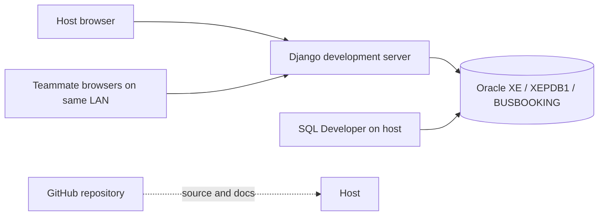
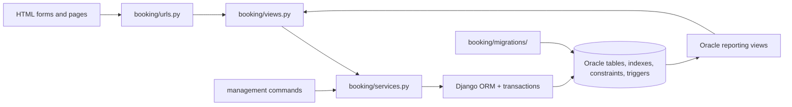
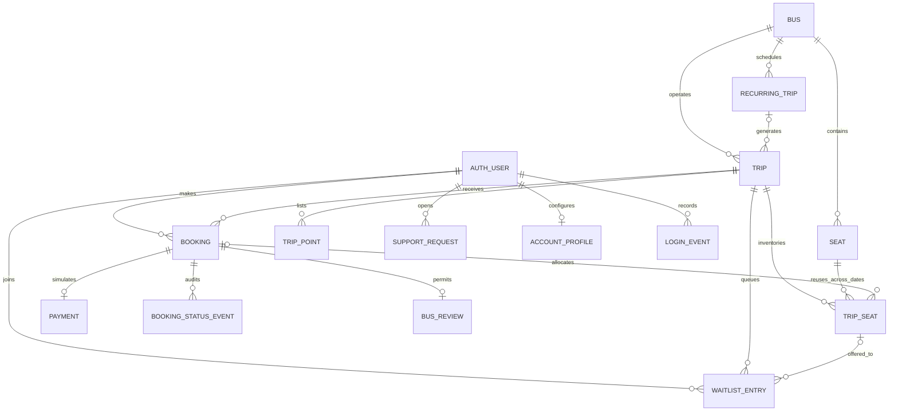

# Bus Ticket Booking System with Seat Reservation, Waiting List, and Cancellation Management

**Detailed project report | Third-year CSE DBMS project | IIITDM Kurnool**  
**Project state reviewed:** 5 November 2026
**Implementation:** Oracle Database 21c XE, Django 6.1.2, Python 3.14, python-oracledb 4.0.2  
**Team:** three students; individual names and institutional approval details are intentionally left for the team to add before submission.

> This report describes the implemented project and the evidence available at the review date. Payments, refunds, operators, routes, fares, and tickets are simulated for academic demonstration. The system is not a real travel or payment service. Live database counts are a dated snapshot, not permanent constants.

## Abstract

The project implements a browser-based bus ticket booking application backed by Oracle 21c XE. A passenger can filter future trips, inspect a bus-style seat map with ordinary seats, sleeping berths and upper decks, select available places, choose boarding and drop-off points, and hold the places for ten minutes. The booking stores passenger contact details and an itemized fare. Confirmation creates a simulated payment and a printable ticket. Cancellation releases all places in the booking and records a simulated full refund. For a full trip, a first-in, first-out waiting list offers a released place to the next passenger for ten minutes. Passengers can later review a completed journey, contact the support desk, view journey history, and change account preferences. Staff maintain buses, recurring schedules and trips, handle support requests, and view operational and revenue reports.

The database is central to the design. Related tables model buses, physical seats, recurring templates, dated trips, per-trip inventory, journey points, bookings, simulated payments, waiting entries, reviews, support requests, account profiles, login events, and status history. Primary, foreign, unique, and check constraints protect local rules. Oracle triggers enforce cross-table consistency and non-overlapping schedules, while function-based unique indexes protect active waiting-list rows and seat offers. The bill constraint rejects a stored total that differs from its components. Atomic transactions and row locks prevent partial reservations and double booking. Analytic SQL gives queue position, reporting views provide live metrics, and a Data Pump export/import drill demonstrated a checkpoint restore. The report also works through functional dependencies, keys, a canonical cover, and BCNF in terms of the implemented model.

The evidence includes a 20-session race with one reservation winner, an all-or-nothing multi-seat rollback probe, FIFO offer promotion, four valid Oracle project triggers, three valid reporting views, a Data Pump restore, and an Oracle check that rejected a one-paisa bill mismatch. On 2 November, `verify_fleet_layout` observed 14 buses with at least 24 places, complete inventory on 111 trips, three double-decker buses, and 80 sleeping berths. On 3 November, `verify_bill_integrity` checked 13 saved bills. These are dated observations, not current live counts; the app and generated trips can change the database after those checks.

## 1. Problem, objectives, and scope

### 1.1 Problem statement

A seat must be available on a particular scheduled trip, not merely on a bus in general. Simultaneous passengers must never receive the same trip seat. A cancellation should release seats and, when demand exists, make a fair offer to a waiting passenger. The project also needs a traceable booking lifecycle, meaningful Oracle objects, and a usable interface so the database rules can be demonstrated in a real workflow.

### 1.2 Objectives

1. Represent bus, route schedule, physical seat, trip inventory, booking, payment, and waiting-list data with clear relationships and minimal repetition.
2. Make seat reservation and cancellation atomic and safe under concurrent requests.
3. Enforce important integrity rules in Oracle, including rules that a simple foreign key cannot express.
4. Provide fair, time-limited waiting-list promotion after a seat is released.
5. Expose database calculations through occupancy, simulated revenue, and queue-position views.
6. Give passengers and staff an application-like interface, while keeping Oracle visible in the demonstration.
7. Produce reproducible evidence: verification commands, SQL worksheets, execution plans, and a backup/restore drill.
8. Keep code and documentation in GitHub checkpoints and support a local shared demo across Wi-Fi or a hotspot.

### 1.3 Implemented scope

The application supports direct origin-to-destination bookings with route, date, bus-type, operator, fare and availability filters. Bus layouts can contain three or four places per row, upper and lower decks, and sleeping berths. Every current bus was expanded to at least 24 places in the recorded upgrade. A booking can hold any number of available places, subject to the trip inventory and transaction checks. Dated trips can be created from daily recurring templates; the schedule guard rejects overlapping active trips for one bus. The passenger flow includes journey-point selection, contact details, a saved fare breakdown, ten-minute holds, simulated capture/refund, whole-booking cancellation, a printable ticket, single-place waiting-list offers, reviews and support. Staff have admin management, overview and revenue pages. Individual accounts, settings, history and local-network team access are implemented.

### 1.4 Deliberate boundaries

There is no real payment gateway, ticket validation at a terminal, SMS/email notification, operator API, segment-based seat reuse, partial booking cancellation, or public production deployment. Boarding and drop-off points are saved for a trip, but the fare and inventory still apply to the full direct trip. The Django development server uses local HTTP; `DEBUG` defaults to enabled and a development fallback secret key exists. Those settings are unsuitable for public internet hosting. The app can run without internet after setup, and teammates can reach one host on a shared local network. GitHub hosts source code and documentation, not the live Oracle database or web app.

## 2. Requirements and methodology

### 2.1 Software and deployment requirements

| Component | Current role | Where it runs |
| --- | --- | --- |
| Oracle Database 21c XE, `xepdb1` | Relational storage, constraints, triggers, indexes, SQL views | Host Windows laptop |
| SQL Developer | Schema inspection, SQL worksheet, execution plans | Host laptop; useful for presentation |
| Python 3.14, Django 6.1.2 | HTTP app, forms, authentication, ORM, admin, business service layer | Host laptop |
| python-oracledb 4.0.2 | Oracle connection through Django backend | Host laptop |
| Browser | Passenger, staff, and admin pages | Host or teammate device |
| PowerShell `start_team.ps1` | Detect local IPv4 addresses and start shared development server | Host laptop |
| Git and GitHub | Versioned code, report, manual, checkpoints | Host or contributors; internet needed for push |

The host computer needs enough memory and disk for Oracle XE, Python, and the browser. Teammates using the shared installation only need a browser and access to the same Wi-Fi or hotspot. Separate installations need their own Oracle instance, Python environment, migrations, and accounts. No measured hardware benchmark or vendor minimum is claimed here.

### 2.2 Development method

Development was incremental: establish the Oracle schema and Django connection; implement the ER model and migrations; build transactional booking; add the queue and cancellation; then strengthen Oracle rules, repeatable probes, reporting, and recovery. Later iterations expanded the fleet and interface, introduced recurring schedules and journey points, added itemized billing and support, and mapped the course topics to worked SQL. Each meaningful checkpoint was committed and pushed to GitHub.

| Stage | Delivered result | Evidence |
| --- | --- | --- |
| Foundation | Dedicated `BUSBOOKING` schema in `xepdb1`; Django Oracle connection | Successful `check` and migrations |
| Logical model | Bus, seat, dated trip, trip inventory, booking, payment and queue | Models, ER notes, migration `0001` onward |
| Core lifecycle | Hold, confirm, cancel, refund, FIFO offer | Ticket, Oracle views, verification commands |
| Database safeguards | Triggers, checks, unique indexes, row locks and audit | Migrations `0003`-`0010`, probes |
| Fleet and service | 24+ place fleet, decks/berths, recurring trips, points, reviews, support | Migrations `0012`-`0013`, fleet verifier |
| Account and billing | Profile/theme/history, bill arithmetic constraint | Migrations `0014`-`0015`, bill verifier |
| Evidence and communication | Data Pump restore, plans, SQL exercises, editable presentation, manual and report | `docs/` artifacts and Git history |

The audit and schedule trigger migrations initially needed PL/SQL recompilation. Follow-up migrations `0007` and `0010` repaired already-applied installations while the original definitions were corrected for fresh installs. The successful Oracle trigger checks are recorded; this is an example of detecting and fixing a real database deployment fault.

## 3. General and technical architecture

### 3.1 Deployment view



The server binds to `0.0.0.0:8000` for a team demo. `start_team.ps1` finds active local IPv4 addresses and sets `BUSBOOK_LAN_HOST`, which Django adds to `ALLOWED_HOSTS`. The host can still use `127.0.0.1`. On a network switch, the server is restarted and a new teammate link is shared; the Oracle database and accounts do not move. A campus network may isolate devices, so a shared hotspot is the fallback. This is local-network access whether the Wi-Fi has internet or not; public hosting is a separate future task.

### 3.2 Application layers and request path



The browser submits standard HTTP forms. URL routing selects a view. Views enforce login and request method rules, read form data, and render templates. The booking service owns atomic changes to booking, seat inventory, payment, and waiting-list rows. Django's Oracle backend maps ORM operations to SQL; some read-only reports are queried with explicit SQL. Oracle commits or rejects the transaction based on schema constraints and triggers. Templates and local CSS present the result. Django admin is a separate staff interface over the same models and schema. Staff overview and revenue pages query operational and financial data for inspection.

**Project modules and responsibility:**

| Module | Responsibility |
| --- | --- |
| `busbooking/settings.py`, `urls.py` | Oracle connection and project URL configuration; host settings |
| `booking/models.py` | Entity fields, relationships, check and unique metadata, admin-facing trip validation |
| `booking/views.py`, `booking/urls.py` | Search, seat map, accounts, booking pages, queue actions, staff insights |
| `booking/services.py` | Atomic hold, confirm, cancel, expiry, FIFO offer, join and leave operations |
| `booking/admin.py` | Bus/seat/trip management and booking/audit inspection |
| `booking/migrations/` | Versioned Oracle DDL: tables, constraints, triggers, indexes, views |
| `booking/management/commands/` | Fleet generation, expiry processing, repeatable DBMS verification probes |
| `templates/booking/`, `booking/static/booking/` | Passenger/staff UI, seat graphics, local stylesheet, college branding |

### 3.3 Principal request and transaction flows

**Seat hold:** The passenger selects one or more available inventory IDs. `hold_seats` starts an atomic transaction, locks the trip, releases stale holds/offers, locks selected trip-seat rows in stable ID order, and rejects a missing, booked, held, or live-offered seat. It validates passenger name and phone and the selected boarding and drop-off points, calculates the itemized bill, and creates a `HELD` booking with a ten-minute deadline and changes every selected inventory row to `HELD` with the same booking and deadline. A failure aborts the entire transaction. The Oracle booking audit trigger records the initial status in the same transaction.

**Confirmation:** `confirm_booking` locks the passenger's booking, checks it remains `HELD` and unexpired, creates one simulated `CAPTURED` payment, marks its inventory `BOOKED`, stores the confirmation time, and changes booking status to `CONFIRMED`. Repeating the request for an already confirmed booking returns the existing booking rather than charging again. The audit trigger records the transition.

**Cancellation:** `cancel_booking` locks the trip, booking, and allocated seats, releases those seats, changes a confirmed payment to `REFUNDED`, records the cancellation time and status, then offers released seats to waiting passengers in FIFO order. A held booking can be cancelled without a payment. A trip that has departed cannot be cancelled through this flow. The booking and payment remain as history; only current seat ownership is cleared.

**Waiting list:** A passenger may join only when no directly bookable seat remains. Active entries have `WAITING` or `OFFERED` status. On release, `_offer_next` selects the oldest waiting entry ordered by `joined_at, id`, locks it, and gives it a specific available seat with a ten-minute expiry. Acceptance calls the same atomic hold operation for that one offered seat, then marks the entry `ACCEPTED`. Leaving or an expired offer can pass the seat to the next passenger. The queue view calculates display positions separately from current status storage.

**Expiry behavior:** Visiting a trip seat map, opening relevant booking history, or running `process_expiries` processes stale holds and offers. The command is available for periodic execution, but a continuously running scheduler is not included. An expiry may therefore be processed at the next visit or command run rather than precisely at the deadline when the system is idle.

### 3.4 Access control, state transitions, and failure boundaries

Public visitors can view the searchable home page and a trip's seat map. Creating a hold, joining/leaving the queue, accepting an offer, viewing personal bookings, confirming, and cancelling require a signed-in user. Booking detail queries filter by both booking ID and `request.user`; a passenger cannot use the normal view to open another passenger's ticket. The Insights view requires Django staff status. Django admin requires staff access; the project leader may grant trusted teammates separate superuser accounts, but this is broad permission and should be used only for the three-person classroom team. Oracle's `BUSBOOKING` login is a different credential from every website login.

| Stored object | Main states | Typical transitions |
| --- | --- | --- |
| Booking | `HELD`, `CONFIRMED`, `CANCELLED`, `EXPIRED` | Hold → confirm; hold → expire/cancel; confirmed → cancel |
| TripSeat | `AVAILABLE`, `HELD`, `BOOKED` | Available → held → booked; held/booked → available after expiry/cancel |
| WaitlistEntry | `WAITING`, `OFFERED`, `ACCEPTED`, `EXPIRED`, `CANCELLED` | Waiting → offered → accepted; offer → expired/left; waiting → left |
| Payment | `CAPTURED`, `REFUNDED` | Confirmed capture → simulated refund on cancellation |

State changes are performed by service functions, and database check constraints restrict impossible status/field combinations. A stale seat selection returns a conflict message and asks the passenger to refresh. A timed-out hold cannot be confirmed. A wrong-trip seat is rejected by an Oracle trigger even if a caller bypasses the browser. If any step in a transaction fails, Oracle rolls back the related booking, inventory, payment, queue and audit writes together. The UI uses the current database values after redirect rather than trusting a previously displayed seat map.

### 3.5 Why this architecture was chosen

Django supplies routing, authentication, forms, admin, templates, and an Oracle-capable ORM quickly enough for a short academic schedule. A separate service module concentrates seat-changing operations so a view or management command does not implement its own competing reservation logic. Oracle owns data integrity, conditional uniqueness, audit history, reporting views, and transaction isolation; these rules continue to apply when data is written through SQL Developer or another client. `TripSeat` trades additional rows for a simple, lockable unit of availability per trip. The result is a demonstrable DBMS project with a working interface, while acknowledging that a production distributed booking system would require more infrastructure and operational controls.

## 4. DBMS architecture and data model

### 4.1 Conceptual and logical model

The model distinguishes a *vehicle and its physical places* from a *dated journey and its saleable inventory*. This distinction is essential: place 7 on one bus can appear in many trips, but only one `TripSeat` row exists for each `(trip, seat)` pair. A booking can own several inventory rows. A waiting entry can temporarily reference one offered inventory row.



The figure is a logical relationship map. Optionality in application workflow differs from a database `NULL` rule: for example, a hold has no payment until confirmation. `AUTH_USER` is Django's authentication relation. Physical table names include prefixes such as `BOOKING_TRIPSEAT` and `BOOKING_WAITLISTENTRY`.

| Relation | Identifiers and foreign keys | Stored facts / cardinality |
| --- | --- | --- |
| `Bus` | `id` PK, `registration_number` unique | Operator, type, row width, upper-deck flag; one bus has many seats/trips |
| `Seat` | `id` PK, `bus_id` FK, `(bus_id,number)` unique | Number, deck, standard seat or berth; belongs to one bus |
| `RecurringTrip` | `id` PK, `bus_id` FK | Daily route/time/duration/fare template; optional source of dated trips |
| `Trip` | `id` PK, `bus_id` FK, nullable `schedule_id` FK | Origin, destination, timestamps, fare and cancellation flag |
| `TripPoint` | `id` PK, `trip_id` FK | Ordered boarding or drop-off name and scheduled time |
| `TripSeat` | `id` PK, `trip_id`/`seat_id` FKs, `(trip_id,seat_id)` unique | Inventory status, optional booking and hold deadline |
| `Booking` | `id` PK, reference unique, user/trip FKs, optional point FKs | State, passenger snapshot, timestamps and bill components |
| `Payment` | `id` PK, unique booking FK | Simulated capture/refund state, amount and times |
| `WaitlistEntry` | `id` PK, user/trip FKs, optional offered-seat FK | Join order, state, offer deadline and queue history |
| `BusReview` | `id` PK, unique booking FK; user/bus FKs | Rating 1-5, comment and time |
| `SupportRequest` | `id` PK, user FK, optional booking FK | Subject, request, state and staff response |
| `BookingStatusEvent` | `id` PK, booking FK | Oracle-created old/new status and timestamp |
| `LoginEvent` | `id` PK, user FK | Optional staff-visible website/admin login trail |
| `AccountProfile` | `id` PK, unique user FK | Phone and light/dark/system preference |

The model deliberately uses `TripSeat` as an associative entity for a many-to-many physical seat/trip relationship constrained by the bus. Foreign keys alone cannot prove that a seat belongs to the trip's bus or that a booking assigned to inventory belongs to the same trip; Oracle triggers enforce those cross-table facts.

### 4.2 Functional dependencies, keys, and normalization

For `Seat`, `(bus_id, number) -> id, seat_type, deck` and `id -> bus_id, number, seat_type, deck`. Thus `id` and `(bus_id, number)` are candidate keys. For `TripSeat`, `(trip_id, seat_id) -> id, status, booking_id, hold_expires_at`, while `id` determines all other columns. Given the cross-table rule that a trip has exactly one bus and the seat number is unique within that bus, `(trip_id, seat_number)` is a *logical* candidate identifier when the seat relation is joined; it is not a declared key of the `TripSeat` table because `seat_number` is stored in `Seat`. `Booking.reference` and `Payment.booking_id` are further alternate keys.

The worked derivation in `docs/fd_normalization_worked_example.md` starts from a wide trip-seat-booking relation, lists its functional dependencies, derives a closure, gives a canonical cover and decomposes it into bus, trip, seat, inventory and booking relations. Example closure: `{trip_id, seat_id}+` reaches trip/seat attributes and booking facts via the declared dependencies, but a nullable booking reference means those booking facts exist only for allocated rows. This separates a teaching example from the nullable production schema. The decomposed core relations satisfy BCNF under the stated FDs because every nontrivial determinant is a superkey in its relation. The application schema also follows 1NF (atomic fields), 2NF (no partial dependence on composite business identifiers) and 3NF (vehicle, schedule, inventory and payment facts separated). We do not claim a formal 4NF/5NF proof for every optional feature table.

Some duplication is intentional and governed: `Booking.base_fare`, fees, tax and total preserve the price agreed at hold time even if `Trip.fare` changes later; passenger contact fields preserve the ticket snapshot when an account profile changes. The DBMS check enforces `total_fare = base_fare + platform_fee + service_fee + gst_amount`. `TripSeat.status` is the current lockable inventory state, while `BookingStatusEvent` preserves transitions. A separate operator relation would be justified if operator contacts, contracts or permissions became first-class data; at present operator name is an attribute of `Bus`.

### 4.3 Physical schema and integrity rules

| DBMS mechanism | Implemented use | Benefit |
| --- | --- | --- |
| Primary and foreign keys | All entities and relationships | Prevent orphan references and give stable joins |
| Ordinary unique constraints | Bus registration, bus seat number, trip-seat pair, booking reference, one payment per booking | Prevent duplicates at the database boundary |
| Check constraints | Positive/nonnegative monetary values, valid statuses, arrival after departure, origin different from destination, coherent inventory and queue states | Reject invalid rows even outside the UI |
| `TRG_TRIPSEAT_SAME_TRIP_BUS` | Seat must belong to trip's bus; assigned booking must belong to same trip | Enforces multi-table rules not expressible by one FK |
| `TRG_WAITLIST_OFFER_TRIP` | Offered inventory seat must belong to waiting entry's trip | Prevents cross-trip offers |
| `TRG_BOOKING_STATUS_AUDIT` | Writes old/new status and time on insert or actual transition | Preserves Oracle-generated lifecycle evidence |
| `TRG_TRIP_NO_OVERLAP` | Serializes scheduling by bus and rejects overlapping active trip intervals | Prevents a bus being in two places at once |
| `UQ_ACTIVE_WAITLIST` | Conditional unique `(trip_id, user_id)` for `WAITING`/`OFFERED` rows | One active queue entry; historical rows can remain |
| `UQ_ACTIVE_OFFER_SEAT` | Conditional unique offered trip-seat for `OFFERED` rows | One live offer per inventory seat |

The schedule overlap predicate is `old.departure_at < new.arrival_at AND old.arrival_at > new.departure_at` for active trips of the same bus. It treats an interval as `[departure, arrival)`, so a new trip may begin exactly when the previous one ends. The admin form checks first for a friendly error; the Oracle compound trigger also guards direct SQL and concurrent scheduling. A cancelled trip does not reserve its old schedule slot. At review, Oracle reported all four triggers `VALID` and zero overlapping active trip pairs.

### 4.4 Transaction isolation, locking, and ACID

The service wraps seat holds, confirmation, cancellation, queue join/leave, and refresh operations in `transaction.atomic`. The trip row is locked first for trip-level serialization; selected inventory or booking rows are then locked with `select_for_update`. The booking and all seats are updated as one unit. Oracle's commit makes changes durable, while an exception rolls the unit back. Database constraints and triggers add independent consistency checks. The fixed lock order helps reduce conflicting acquisition patterns; the work does not claim a proof against every possible deadlock.

This matters because a read-then-write check without a lock can let two sessions both observe an available seat. The 20-session race probe produced exactly one successful hold, 19 conflicts, and one held booking. The separate atomicity probe injected a second-seat failure and observed that neither the first seat nor a partial booking survived. These are observed tests on the local setup, not a production-load benchmark.

### 4.5 Views, analytic SQL, indexes, and query plans

`V_TRIP_OCCUPANCY` groups trip-seat inventory and calculates total, booked, available, and occupancy percentage. `V_TRIP_REVENUE` aggregates simulated captures and refunds by trip. `V_WAITLIST_QUEUE` filters active entries and uses `ROW_NUMBER() OVER (PARTITION BY trip_id ORDER BY joined_at, id)` to give FIFO position. The staff Insights page queries the first two views for trip metrics and groups queue rows for waiting and unexpired-offer counts. The passenger booking page queries the queue view for position. These are ordinary live views, not stored dashboard snapshots.

`IDX_TRIP_SEARCH` indexes origin, destination, and departure time; `IDX_WAITLIST_FIFO` indexes trip, status, join time, and ID; `IDX_BOOKING_USER_CREATED` helps a passenger's booking history. The active uniqueness indexes use `CASE` expressions so only active rows participate. A recorded Oracle plan for an exact Kurnool-to-Vijayawada query showed an `INDEX RANGE SCAN` on `IDX_TRIP_SEARCH` followed by table lookup. Another plan used `IDX_WAITLIST_FIFO` for trip and waiting status. The plans' costs were optimizer estimates on a small data set; no measured speedup is claimed. The UI's substring city search may choose a different plan than the exact-match worksheet query.

### 4.6 Backup, restore, and migration provenance

Oracle Data Pump exported the `BUSBOOKING` schema to a server-side dump and imported a checkpoint into `BUSBOOKING_RESTORE` with `REMAP_SCHEMA`. The restored *historical checkpoint* held one trip, ten inventory rows, five bookings, five payments and one waiting entry; three views and the two then-existing triggers were valid. The separate restore account was removed afterward. This demonstrated point-in-time recovery, not ongoing scheduled backups. No private dump or password was placed in GitHub.

Django migration provenance is explicit: `0001` base domain, `0002` payment, `0003` integrity triggers, `0004` reporting views, `0005` active-queue uniqueness, `0006`-`0007` audit trigger and repair, `0008` offer rules, `0009`-`0010` schedule guard and repair, `0011` login events, `0012` fleet layout/passenger fields/recurrence, `0013` service-billing-reviews, `0014` account profiles, and `0015` bill integrity. Existing installations apply only outstanding migrations; the recorded user run applied `0015` successfully. The Git repository stores migration source, not a copy of the live Oracle data.

### 4.7 DBMS concept-to-implementation map

| Course concept | Implementation and evidence | Why it matters |
| --- | --- | --- |
| ER model and cardinality | Bus-seat-trip-inventory-booking-queue map above | Distinguishes physical place from its dated availability |
| Keys and FDs | Surrogate PKs, natural alternate keys, closure/canonical-cover exercise | Identifies rows and explains normalization |
| 1NF/2NF/3NF/BCNF | Decomposition of wide example into core relations | Prevents route/vehicle update anomalies |
| Referential integrity | FKs between domain tables and `AUTH_USER` | Blocks orphan references |
| Domain and arithmetic constraints | Status/time/fare rules; `0015` nonnegative parts and exact bill sum | Rejects malformed rows including a one-paisa discrepancy |
| Conditional uniqueness | Function-based `UQ_ACTIVE_WAITLIST` and `UQ_ACTIVE_OFFER_SEAT` | Keeps history while forbidding competing active rows |
| Triggers and PL/SQL | Same-bus/same-trip, offer-trip, audit, no-overlap rules | Protects cross-table rules even for direct SQL |
| Transactions, locking, ACID | Atomic hold/confirm/cancel and `select_for_update` | Prevents partial or double reservations |
| Joins and aggregates | Occupancy/revenue views and course SQL worksheet | Reconstructs reports from normalized data |
| Analytic functions | `ROW_NUMBER()` queue order in `V_WAITLIST_QUEUE` | Derives FIFO positions without mutable counters |
| Nested queries and set operations | `docs/course_sql_lab.sql` examples | Demonstrates course SQL on real project relations; worksheet is instructional, with no claimed live run |
| Indexing and access paths | Trip/FIFO composite indexes; recorded `EXPLAIN PLAN` | Shows actual index scans for exact-match examples |
| Backup and recovery | Data Pump export and separate-schema import | Demonstrates restoration of a past checkpoint |

Application checks provide useful error messages. Oracle constraints, indexes and triggers provide an independent database boundary for the rules they express. `docs/course_alignment.md` distinguishes implemented runtime rules from instructional SQL examples, so the project does not present a worksheet as a deployed feature.

## 5. Implemented application features

| Audience | Feature | Data and behavior |
| --- | --- | --- |
| Visitor | Filter and sort trips by route, date, bus type, operator, fare and seats available | Searchable dated `Trip` rows with availability |
| Passenger | Register, sign in, edit profile and theme, change password, inspect history | `AUTH_USER`, `AccountProfile`, session and owned bookings |
| Passenger | Inspect bus map with lower/upper deck, standard seats/berths, steering and door cues | `Bus` layout and `Seat` type/deck; live `TripSeat` status |
| Passenger | Select available places, boarding/drop-off, name and phone | `TripPoint` and `Booking` snapshots |
| Passenger | See base fare, platform/service fees, illustrative GST and total; hold places for ten minutes | Database-constrained bill and atomic inventory update |
| Passenger | Confirm a simulated payment and print branded ticket with date/time and journey points | `Payment`, audit, printable booking |
| Passenger | Cancel whole booking, receive simulated full refund | Transactional release, refund and FIFO promotion |
| Passenger | Join/leave waiting list, see position, accept expiring single-seat offer | `WaitlistEntry`, analytic view and active unique indexes |
| Passenger | Submit one verified review after a completed confirmed trip; contact support | `BusReview`, `SupportRequest` and staff reply |
| Staff | Manage vehicles, layouts, recurring templates, dated trips, users and support | Django admin over Oracle tables |
| Staff | View operations overview, revenue/refunds, trip occupancy and waiting demand | Oracle views plus operational queries |
| Team | Use one Windows host on localhost or shared Wi-Fi/hotspot, with separate accounts | `start_team.ps1`; no public web deployment |

The interface includes responsive trip cards, a seat map with availability states, status badges, a printable ticket, college branding, customer-help footer, FAQ and optional login history in staff administration. Payment and refund numbers are simulated. The billing example is a project pricing policy, not a representation that a real operator levies these particular charges or tax treatment.

## 6. Verification, observed results, and present state

### 6.1 Repeatable database tests

| Test | Recorded result |
| --- | --- |
| `verify_integrity` | Oracle rejected wrong-bus seat (`ORA-20001`), wrong-trip booking (`ORA-20002`), wrong-trip offer (`ORA-20003`) |
| `verify_seat_race` | 20 distinct Oracle sessions; one hold winner, 19 conflicts, one held booking |
| `verify_atomic_hold` | Injected second-seat failure rolled back first seat and booking |
| `verify_waitlist_fifo` | First passenger offered released place; expiry passed it to second, who accepted |
| `verify_waitlist_leave` | Analytic view showed positions 1/2; departure passed offer and updated position |
| `verify_active_waitlist` | `ORA-00001` rejected duplicate active queue entry; later rejoin allowed |
| `verify_offer_rules` | Rejected second active offer and malformed states; reoffer after cancellation allowed |
| `verify_booking_audit` | Oracle recorded `NULL -> HELD -> CONFIRMED -> CANCELLED`; probe rolled back |
| `verify_trip_schedule` | Same-bus overlap rejected; adjacent and different-bus trips accepted |
| `verify_fleet_layout` | On 2 Nov: 14 buses with 24+ places, 111 trips with complete inventory, 3 double-deckers, 80 berths |
| `verify_bill_integrity` | On 3 Nov: 13 bills balanced; a one-paisa invalid total rejected with `ORA-02290`; no booking changed |
| `manage.py check` and `migrate` | User reported no system-check issues and migration `0015` applied successfully |

Test commands use isolated probe rows or remove their temporary data as stated in their outputs. These results are evidence of particular cases, not a proof of all possible interleavings or production load. The one-paisa row was intentionally invalid test data; rejection is the desired behavior, so no stored bill needed a repair.

### 6.2 Dated observations and scope of counts

| Date and checkpoint | Observation | Interpretation |
| --- | --- | --- |
| 2 Nov, read-only earlier snapshot | 13 buses, 33 trips, 244 physical places, 640 trip-seat rows | Historical count before later fleet expansion |
| 2 Nov, fleet verifier after upgrade/generation | 14 buses with 24+ places; 111 complete-inventory trips; 3 double-deckers; 80 berths | Later verified fleet condition, not guaranteed current count |
| 3 Nov, bill verifier | 13 saved bills balanced | Later sample of stored bookings |
| Earlier Data Pump checkpoint | 1 trip, 10 inventory rows, 5 bookings, 5 payments, 1 queue entry | Separate restored historical snapshot |

The earlier 13-bus/33-trip numbers and the later 14-bus/111-trip verifier come from different moments and must not be merged into one live total. The report preparation did not reconnect to the user's private Oracle schema, so no 5 November live totals are claimed. The latest counts should be read from `V_TRIP_OCCUPANCY` and the tables on presentation day.

### 6.3 Query plans, recovery, and remaining verification

Recorded Oracle plans used `IDX_TRIP_SEARCH` for an exact Kurnool-Vijayawada route predicate and `IDX_WAITLIST_FIFO` for a trip's waiting rows. These show chosen access paths on a small dataset, not a benchmarked speedup. The Data Pump exercise restored a checkpoint into a separate schema and validated objects/rows; it does not establish automatic backup scheduling. The course SQL worksheet contains additional nested and set-operation examples, but no successful live execution of that new worksheet is asserted here. The team launcher was reported working locally; a full teammate-device test on the exact college Wi-Fi is still a presentation rehearsal task, since campus device isolation can prevent peer access.

## 7. Planned versus achieved

| Initial intention | Achieved | Remaining boundary |
| --- | --- | --- |
| Strong DBMS focus | ER/FD/key study, normalized core, constraints, PL/SQL triggers, unique indexes, ACID/locks, views, analytic SQL, plans and recovery | Larger measured performance study optional |
| Reservation, queue, cancellation | Working hold-confirm-cancel flow, FIFO expiry/acceptance, simulated refunds and ticket | No partial cancellation or segment reuse |
| Useful UI | Search, graphical layouts, decks/berths, ticket, account settings, staff pages | Accessibility/device rehearsal can improve |
| Rich fleet | 14 buses with 24+ places and 111 complete trips verified 2 Nov; recurring generation and overlap guard | Not a live operator feed |
| Passenger service | Journey points, bill, verified review, FAQ/support | No SMS, live agents or payment gateway |
| Team and submission | Local team launcher, separate site accounts, GitHub checkpoints, manual, editable presentation and report | Institutional names/formatting and live demo rehearsal remain |

## 8. Limitations and future improvements

**Operational near term.** Run expiry processing on a real scheduler rather than relying on visits or a manual command; add a browser-level regression path from hold to refund and queue to acceptance; rehearse on the intended LAN/hotspot and projector; improve keyboard and screen-reader operation; establish scheduled, verified database backups. These steps are useful before any wider demonstration.

**Data-model evolution.** Normalize operators when their accounts, contacts and contracts are managed. Add stop-to-stop segment inventory and fares, so a seat can be reused on non-overlapping segments of one trip. Model individual passenger details for each selected place, partial cancellation, maintenance blocks and mandatory turnaround time. Recurring templates currently create dated trips ahead of time; they are not an infinite schedule or live operator timetable.

**Service and deployment.** Integrate a genuine payment provider and reconciliation only with appropriate controls; add notifications and a verifiable ticket token; use more granular staff roles. For public hosting, configure production secret management, `DEBUG=False`, HTTPS, secure cookies, restricted database credentials, a production web server, monitoring and backups. The current local HTTP development server and simulated transactions are not a public ticketing service.

**DBMS research.** Compare execution plans and measured timings on a representative larger dataset; inspect statistics and selectivity; exercise concurrent queue joins and trip scheduling; consider archival or partitioning only if data volume warrants it. These are proposals, not measured present benefits.

## 9. Conclusion

The project delivers a functioning browser workflow whose decisive rules are anchored in an Oracle relational design. `TripSeat` makes each dated place explicit; functional dependencies and keys explain the separation of vehicle, trip, inventory, booking and payment. Constraints, conditional unique indexes and PL/SQL triggers protect state, cross-table consistency, schedule integrity and audit transitions. Atomic transactions and row locks address competing seat requests, and live views turn normalized rows into occupancy, revenue and FIFO evidence. Passenger features, staff administration, a restored checkpoint, verification probes and the editable presentation make that database work demonstrable. The remaining limits are clearly identified: this is a local academic simulation with simulated payments and no public deployment.

## Appendix A. Reproduction and demonstration commands

In a *new* PowerShell session in the project folder, enter the `BUSBOOKING` password without printing it:

```powershell
$secure = Read-Host "BUSBOOKING password" -AsSecureString
$env:DB_PASSWORD = [System.Net.NetworkCredential]::new("", $secure).Password
.\.venv\Scripts\python.exe manage.py check
.\.venv\Scripts\python.exe manage.py migrate
.\.venv\Scripts\python.exe manage.py verify_fleet_layout
.\.venv\Scripts\python.exe manage.py verify_bill_integrity
.\.venv\Scripts\python.exe manage.py verify_integrity
.\.venv\Scripts\python.exe manage.py verify_seat_race
.\.venv\Scripts\python.exe manage.py verify_atomic_hold
.\.venv\Scripts\python.exe manage.py verify_waitlist_fifo
.\.venv\Scripts\python.exe manage.py verify_waitlist_leave
.\.venv\Scripts\python.exe manage.py verify_active_waitlist
.\.venv\Scripts\python.exe manage.py verify_booking_audit
.\.venv\Scripts\python.exe manage.py verify_offer_rules
.\.venv\Scripts\python.exe manage.py verify_trip_schedule
```

`seed_fleet`, `upgrade_fleet`, and `generate_daily_trips --days 14` change persistent demo data; run them only when intentional. For team access use `powershell -NoProfile -ExecutionPolicy Bypass -File .\start_team.ps1`; open the displayed localhost link on the host and the printed local IPv4 link on teammate devices on the same network. Restart after switching networks. In SQL Developer, connect to `BUSBOOKING` in `xepdb1` and examine `docs/dbms_evidence.sql`, `docs/query_plans.sql`, `docs/live_sql_demo.sql`, and `docs/course_sql_lab.sql`; run statements individually and check their output. The detailed setup and feature guide is in `README.md` and the team manual.

## Appendix B. Project evidence and source map

The public source repository is https://github.com/karthik-goud227/bus-ticket-booking-system. The main implementation is in `booking/models.py` (entities/keys), `booking/services.py` (transactions), `booking/views.py` (request handling), `booking/admin.py` (staff management), `busbooking/settings.py` (Oracle and local host configuration), `booking/migrations/0001` through `0015` (versioned schema), `booking/management/commands/` (probes and fleet tasks), `templates/booking/` and `booking/static/booking/` (UI). Supporting evidence is `docs/er_model.md`, `docs/dbms_design.md`, `docs/fd_normalization_worked_example.md`, `docs/course_alignment.md`, `docs/course_sql_lab.sql`, `docs/observed_dbms_results.md`, `docs/recovery_drill.md`, `docs/query_plans.sql`, `docs/live_sql_demo.sql`, and `docs/fleet_schedule.md`. The editable slides are `docs/BusBook_DBMS_Presentation_Updated.pptx`; the team manual is `docs/BusBook_Team_User_Manual.pdf`.

Evidence in this report distinguishes verified command outputs, dated historical database snapshots, and features established by reading the implemented source. It does not assert a fresh live Oracle query for 5 November 2026.

## Appendix C. Terms used in the demonstration

| Term | Meaning in BusBook |
| --- | --- |
| Candidate key | Minimal set of attributes that identifies a relation row, such as `(bus_id, number)` for a physical seat. |
| Functional dependency | A rule such as `(trip_id, seat_id) -> status`, used to reason about decomposition. |
| BCNF | A normal form in which every nontrivial functional-dependency determinant is a superkey. The worked core decomposition is analyzed under stated assumptions. |
| Inventory row | One `TripSeat` record representing one physical place on one dated trip. |
| Hold | A temporary booking state; selected inventory is reserved for ten minutes before confirmation. |
| Conditional uniqueness | An Oracle function-based unique index that applies only when a queue row is active. |
| Atomicity | All related changes in one business action commit together or roll back together. |
| Row lock | A database lock on selected trip, booking or inventory rows that serializes competing changes. |
| Analytic function | `ROW_NUMBER()` computes queue order across rows without collapsing them into one aggregate. |
| Live view | Saved SQL definition evaluated against current table data; occupancy and revenue are not copied dashboard totals. |
| Data Pump checkpoint | A dated export/import exercise used to show that an earlier schema and its data can be restored. |
